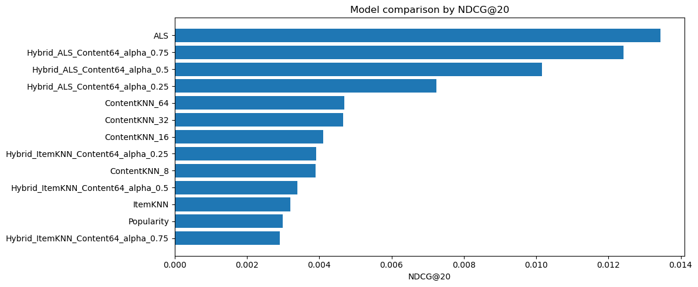

# Hybrid Video Recommendations on VK-LSVD

An offline ranking experiment by Bogdan Pravdukhin for VK internship. It compares collaborative filtering with video content embeddings and measures the trade-off between ranking quality and catalog coverage.

## Results

| Model | Recall@20 | HitRate@20 | NDCG@20 | Catalog coverage@20 | Rare-item Recall@20 |
| --- | ---: | ---: | ---: | ---: | ---: |
| Popularity | 0.003810 | 0.065000 | 0.002994 | 0.51% | 0.000000 |
| ItemKNN | 0.003875 | 0.069167 | 0.003192 | 8.68% | 0.000000 |
| ALS | **0.012198** | **0.190833** | **0.013432** | 3.56% | 0.000000 |
| ALS + ContentKNN-64 (75% ALS weight) | 0.011661 | 0.171667 | 0.012417 | 22.66% | 0.000598 |
| ContentKNN-64 | 0.004202 | 0.075000 | 0.004688 | 44.46% | 0.001948 |
| ContentKNN-8 | 0.002753 | 0.063333 | 0.003899 | **58.60%** | **0.003447** |

ALS led on NDCG@20 and returned at least one relevant video for 19.08% of evaluated users. Adding ContentKNN with a 25% weight increased coverage from 3.56% to 22.66%, with a 7.6% relative drop in NDCG@20. ContentKNN-8 reached the most distinct videos and had the highest rare-item recall@20, which was still low in absolute terms.

See the [full results for all 13 configurations](final_metrics.csv) and the [executed notebook](vk_lsvd_recommender.ipynb).



## Experiment

- Used the [VK-LSVD dataset](https://huggingface.co/datasets/deepvk/VK-LSVD) and its `up0.001_ip0.001` subsample. Training used the first 250,000 rows of week 24. Validation used week 25, with evaluation on the same 1,200 users across models.
- Built weighted implicit feedback from reactions and watch time. Validation targets were positive interactions with videos in the training catalog that the user had not interacted with in training.
- Compared weighted Popularity, cosine ItemKNN, implicit ALS, cosine ContentKNN, and rank-based hybrids. The hybrids combine reciprocal ranks from both models using three different weights.
- Compared the first 8, 16, 32, and 64 coordinates of one supplied embedding. These settings test truncation of the same representation.
- Defined rare videos as those with at most five training interactions. Videos absent from training were outside the evaluation catalog. Coverage counts distinct recommended videos across users as a share of that catalog.
- Repeated evaluation for four models on three 400-user samples to check sensitivity to the choice of evaluation users. This check uses the same trained models. See the [stability summary](stability_summary.csv).

## Run locally

From the repository root, create a Python environment and start JupyterLab.

```bash
python3 -m venv .venv
source .venv/bin/activate
python -m pip install -r requirements.txt
python -m jupyterlab
```

Open `vk_lsvd_recommender.ipynb` and run the cells in order. The notebook downloads data from Hugging Face to `data/VK-LSVD/` and writes fresh results to `outputs/`. The embedding archive alone is approximately 2.36 GB, so a full run requires several GB of free disk space and enough RAM to load the array.

The checked-in results come from the saved Jupyter run. They describe one temporal split and one subsample. No independent test split or significance test was included.
